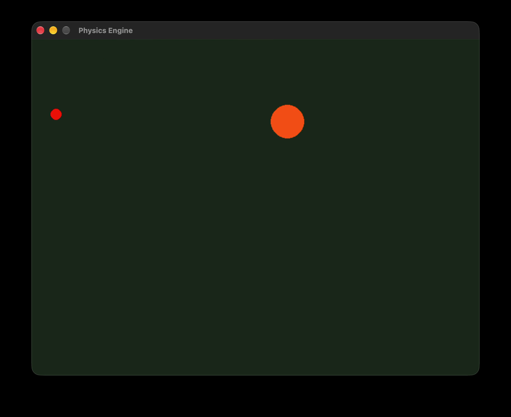

# 2D Physics Engine

A 2D physics simulation built with Python and Pygame. It simulates circular bodies under gravity, detects collisions, and calculates collision responses using impulse-based mechanics.

## Features

- Gravity and motion using semi-implicit Euler integration
- Circle-to-circle collision detection
- Impulse-based collision response
- Mass-dependent velocity changes
- Coefficient of restitution
- Positional correction for overlapping bodies
- Wall collision detection and bouncing



## Requirements

- Python 3
- Pygame

## Installation

Clone the repository:

```bash
git clone https://github.com/thyfrei/2D-Physics-Engine.git
cd 2D-Physics-Engine
```

Create and activate a virtual environment:

```bash
python3 -m venv .venv
source .venv/bin/activate
```

Install Pygame and run the simulation:

```bash
python -m pip install pygame
python main.py
```

## Physics and Implementation

### 1. Motion Under Gravity

The simulation updates velocity and position at discrete time intervals.

Vertical velocity:

$$
v_y^{\text{new}}=v_y^{\text{old}}+g\Delta t
$$

Vertical position:

$$
y^{\text{new}}=y^{\text{old}}+v_y^{\text{new}}\Delta t
$$

Here, $$\(g\)$$ is gravitational acceleration and $$\(\Delta t\)$$ is the elapsed time between updates. The simulation uses \(g=981\) pixels/s².

This is **semi-implicit Euler integration**, which updates velocity before position.

### 2. Collision Detection

For two circles with centers $$\(P_1=(x_1,y_1)\) and \(P_2=(x_2,y_2)\)$$, the center-to-center distance is

$$
d=\sqrt{(x_1-x_2)^2+(y_1-y_2)^2}
$$

A collision is detected when

$$
d\leq r_1+r_2
$$

where $$\(r_1\)$$ and $$\(r_2\)$$ are the circle radii.

### 3. Collision Normal

The collision normal is a unit vector along the line connecting the centers. In this implementation, it points from the second ball toward the first.

$$
\mathbf n=
\begin{bmatrix}
(x_1-x_2)/d\\
(y_1-y_2)/d
\end{bmatrix}
$$

It defines the direction along which the collision impulse and positional correction act.

### 4. Relative Velocity

The relative velocity is

$$
\mathbf v_{\text{rel}}=\mathbf v_1-\mathbf v_2
$$

Its component along the collision normal is

$$
v_{\text{rel},n}=\mathbf v_{\text{rel}}\cdot\mathbf n
$$

- $$\(v_{\text{rel},n}<0\)$$: the bodies are approaching.
- $$\(v_{\text{rel},n}>0\)$$: the bodies are separating.
- $$\(v_{\text{rel},n}=0\)$$: there is no relative motion along the normal.

The impulse calculation is skipped when the bodies are separating.

### 5. Impulse-Based Collision Response

An impulse changes momentum:

$$
\mathbf J=\Delta\mathbf p
$$

For two bodies with masses $$\(m_1\)$$ and $$\(m_2\)$$, the normal impulse magnitude is

$$
j=-\frac{(1+e)v_{\text{rel},n}}
{\frac{1}{m_1}+\frac{1}{m_2}}
$$

where $$\(e\)$$ is the coefficient of restitution.

The velocities are updated as

$$
\mathbf v_1'=\mathbf v_1+\frac{j}{m_1}\mathbf n
$$

$$
\mathbf v_2'=\mathbf v_2-\frac{j}{m_2}\mathbf n
$$

The impulse acts in opposite directions on the two bodies. Inverse mass determines the magnitude of each body's velocity change.

### 6. Coefficient of Restitution

The coefficient of restitution describes the ratio between the normal relative speeds after and before a collision:

$$
e=-\frac{v_{\text{rel},n}^{\text{after}}}
{v_{\text{rel},n}^{\text{before}}}
$$

Typical values are:

| Value | Collision type |
|---|---|
| \(e=1\) | Perfectly elastic |
| \(0<e<1\) | Partially elastic |
| \(e=0\) | Zero normal relative separation speed |

The simulation uses \(e=0.8\) for ball and wall collisions.

### 7. Positional Correction

Penetration depth is calculated as

$$
p=r_1+r_2-d
$$

For $$\(p>0\)$$, the bodies overlap. Define inverse masses as

$$
w_1=\frac{1}{m_1},\qquad
w_2=\frac{1}{m_2}
$$

The correction magnitudes are

$$
c_1=p\frac{w_1}{w_1+w_2},
\qquad
c_2=p\frac{w_2}{w_1+w_2}
$$

The positions are corrected along the collision normal:

$$
\mathbf x_1'=\mathbf x_1+c_1\mathbf n
$$

$$
\mathbf x_2'=\mathbf x_2-c_2\mathbf n
$$

This separates overlapping bodies, distributing the correction according to inverse mass.

### 8. Wall Collisions

For a screen of width \(W\), height \(H\), and a ball of radius \(r\), the center is constrained to remain within the screen boundaries.

At the bottom wall:

$$
y=H-r,\qquad v_y'=-e|v_y|
$$

At the top wall:

$$
y=r,\qquad v_y'=e|v_y|
$$

Horizontal wall collisions similarly correct $$\(x\)$$ and reverse $$\(v_x\)$$. The implementation also applies horizontal velocity damping when a ball contacts the floor.

## Code Structure

| Component | Responsibility |
|---|---|
| `Ball` | Stores position, velocity, radius, and mass. |
| `Ball.update()` | Updates motion and handles wall collisions. |
| `checkCollision()` | Detects overlap between circles. |
| `afterCollision()` | Applies positional correction and collision impulses. |
| Main loop | Handles events, updates the simulation, and renders the scene. |

## Limitations

- Discrete collision detection can cause tunnelling at high velocities.
- The current demonstration handles two balls rather than a general set of bodies.
- Floor damping is a simplified approximation of friction.
- Large time steps can reduce numerical accuracy.
- Coincident centers require special handling because the collision normal is undefined.
- Simultaneous contacts may require a more advanced collision solver.

## Future Improvements

- Multiple-body collision handling
- Continuous collision detection
- Friction and rotational dynamics
- Configurable physical parameters
- Velocity-vector and energy visualization
- Improved contact resolution

## License

Distributed under the MIT License. See [`LICENSE`](LICENSE) for details.